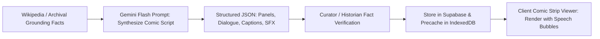

# ARCHITECTURE.md — POYALO System Architecture & Component Topology

> **Architecture Style:** Offline-First Progressive Web Application (PWA) with WebGL 3D Engine & Real-Time Presence  
> **Target Platform:** Modern Mobile Browsers (iOS Safari, Android Chrome, Desktop PWA)  
> **Key Quality Invariant:** 100% of core verification and comic storytelling logic executes locally in client runtime.  

---

## 1. System Topology Overview

```
+---------------------------------------------------------------------------------------------------+
|                                       CLIENT PWA RUNTIME                                          |
|                                                                                                   |
|  +---------------------------------------------------------------------------------------------+  |
|  |                                  PRESENTATION LAYER (React)                                 |  |
|  |   [ Mobile Bottom Dock ]  [ Boarding Pass UI ]  [ Comic Strip Viewer ]  [ 3D Game Canvas ]   |  |
|  +---------------------------------------------------------------------------------------------+  |
|                                                |                                                  |
|  +---------------------------------------------------------------------------------------------+  |
|  |                                APPLICATION STATE (Zustand Stores)                           |  |
|  |     usePlanStore     |     useComicStore     |     useGameStore     |     useProviderStore   |  |
|  +---------------------------------------------------------------------------------------------+  |
|                        |                                               |                          |
|  +--------------------------------------------+  +---------------------------------------------+  |
|  |         DETERMINISTIC CLIENT ENGINES       |  |             3D WEBGL ENGINE (Three.js)      |  |
|  |  * Reality Check Rule Auditor (Hours, Speed)|  |  * Low-Poly District Scene (Al Fahidi/Creek)|  |
|  |  * Entry Check (Passport & Visa Matrix)    |  |  * Virtual Joystick & Camera Orbit Rig      |  |
|  |  * SunCalc Astronomical Solar Calculator   |  |  * 3D Collectible Proximity Detector        |  |
|  |  * Haversine Geofence Distance Watcher     |  |  * Avatar Renderer & Lerp Interpolator      |  |
|  +--------------------------------------------+  +---------------------------------------------+  |
|                        |                                               |                          |
|  +---------------------------------------------------------------------------------------------+  |
|  |                              OFFLINE STORAGE LAYER (IndexedDB / Dexie)                      |  |
|  |    places_cache    |    comic_strips_cache    |    stamps_vault    |    game_scores_local   |  |
|  +---------------------------------------------------------------------------------------------+  |
|                                                |                                                  |
|  +---------------------------------------------------------------------------------------------+  |
|  |                          SERVICE WORKER & CACHE STORAGE (Workbox PWA)                       |  |
|  |     App Shell (HTML/CSS/JS)   |   3D glTF Models & Textures   |   Audio & Map Assets        |  |
|  +---------------------------------------------------------------------------------------------+  |
+---------------------------------------------------------------------------------------------------+
                                                 |
                                (HTTPS & WebSockets When Online)
                                                 v
+---------------------------------------------------------------------------------------------------+
|                                      SERVERLESS EDGE & DATA                                       |
|                                                                                                   |
|  +-------------------------------------+   +---------------------------------------------------+  |
|  |     SERVERLESS EDGE FUNCTIONS       |   |                 SUPABASE POSTGRESQL               |  |
|  |  * POST /api/parse-plan (Gemini)    |   |  * places, comic_stories, providers, requests     |  |
|  |  * POST /api/comic/generate-panels  |   |  * game_collectibles, district_leaderboards       |  |
|  |  * POST /api/auth/provider-pin      |   |  * SUPABASE REALTIME (WebSockets: Presence/Emotes)|  |
|  +-------------------------------------+   +---------------------------------------------------+  |
|                    |                                                                              |
|                    v                                                                              |
|  +-------------------------------------+                                                          |
|  |         GOOGLE GEMINI API           |                                                          |
|  |   Gemini 1.5/2.0 Flash (Server-Only)|                                                          |
|  +-------------------------------------+                                                          |
+---------------------------------------------------------------------------------------------------+
```

---

## 2. 3D WebGL & Multiplayer Subsystem Architecture

### 2.1 Three.js Game Architecture
- **Scene Manager:** Loads low-poly glTF models for the active district (Al Fahidi Creek) using `GLTFLoader`. Assets are Draco-compressed.
- **Render Loop:** Managed via `requestAnimationFrame` with delta-time throttling. Calculates character physics, collectible spin animations, and camera damping.
- **Mobile Input Controller:**
  - Decoupled touch handlers for the virtual joystick and orbit camera.
  - Updates velocity vector $\vec{v}$ applied to the player's 3D avatar.

### 2.2 Real-Life Human Multiplayer via Supabase Realtime
- **Channel Architecture:** Subscribes to room `game:district-dubai` via Supabase Realtime WebSockets:
  1. `presence`: Tracks connected player IDs, display names, and initial spawn coordinates.
  2. `broadcast`: Broadcasts player position/rotation updates at 10 Hz when moving.
  3. `broadcast:emote`: Broadcasts proximity greetings (`"Marhaba! 👋"`, `"Yalla! 🚀"`), rendering animated speech bubbles above avatars.
- **Client Interpolation:** The remote player mesh positions are smoothly interpolated at 60 FPS using linear interpolation (`lerp`) to eliminate stutter.

---

## 3. Comic-Book Story Generation & Rendering Subsystem



- **Data Structure:** Each comic story is represented as an array of structured panel objects with character avatars, dialogue strings, narrative boxes, and sound effect stickers.
- **Client Renderer:** High-performance responsive CSS Grid / Flexbox layout with SVG speech bubble pointers and halftone dot background styling.
